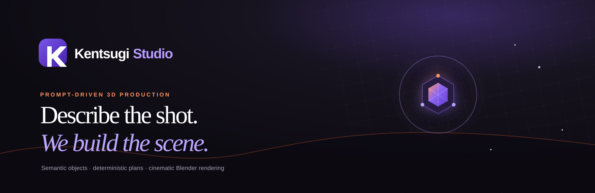

# Kentsugi

> **Proprietary software — Copyright © 2026 web3voyage. All rights reserved.**



Kentsugi is a prompt-driven 3D production engine. It turns natural-language
intent into validated, declarative scene and object data, solves layout and
timing outside Blender, and renders the result through a tightly bounded
Blender backend.

**Repository description:** A sophisticated prompt-to-3D production platform
with semantic object generation, trusted procedural assets, deterministic scene
planning, cinematic Blender rendering, versioned knowledge, and a web-based
creative studio.

The merged build includes the object-generation engine, trusted blueprints and
asset recipes, versioned review knowledge, a prompt/job API, procedural product
and character assets, cinematic studio rendering, and the Kentsugi Studio UI.
The original dependency-free JSON workbench remains available for low-level
scene inspection.

## Architecture

```text
prompt
  -> planner / semantic ObjectSpec
  -> trusted blueprint or catalog asset selection
  -> strict scene validation
  -> relation-based layout solver
  -> deterministic timeline baker
  -> SVG preview or Blender renderer
  -> versioned review / approval record
```

The model emits data, never Python, Blender commands, arbitrary file paths, or
asset coordinates. Catalog ids and blueprint ids are resolved by trusted local
registries. This keeps generated intent useful without making it executable.

## Quick Start

The core engine uses only the Python standard library:

```powershell
python -m kentsugi doctor
python -m kentsugi catalog
python -m kentsugi validate examples\aura_ad.json
python -m kentsugi plan examples\aura_ad.json
python -m kentsugi preview examples\aura_ad.json --open
python -m kentsugi object "Create a black and green energy drink can"
python -m unittest discover -s tests -t .
```

On this development machine, use Cycles because headless EEVEE is not supported
by the available OpenGL implementation:

```powershell
python -m kentsugi render examples\smoke.json -o out\smoke.png --engine cycles --frame 1 --samples 2 --resolution-scale 25
python -m kentsugi render examples\aura_ad.json -o out\aura.mp4 --engine cycles --keep-blend
```

`--engine auto` performs a small isolated EEVEE probe and falls back to Cycles
when necessary. A full-resolution Cycles video can take a long time; use a
single low-sample PNG while developing assets and materials.

## Object Engine

The object command converts a prompt into an `ObjectSpec`, ranks compatible
trusted blueprints, compiles a scene, runs bounded checks, and writes an
immutable knowledge record:

```powershell
python -m kentsugi object "Create a black and green energy drink can"
```

Render a review frame and keep the result pending for inspection:

```powershell
python -m kentsugi object "Create a luxury black perfume bottle" --render-output out\perfume.png --engine cycles --frame 1 --samples 8 --resolution-scale 50
```

Approval is explicit. An inspected artifact can be attached to a new immutable
record with `--artifact ... --approve`; unrendered generations remain
`pending_render`, and rendered but unapproved generations remain
`pending_review`.

Kentsugi also retains the original Asset Forge and procedural skill memory:

```powershell
python -m kentsugi forge assets\blueprints\soda_can.json
python -m kentsugi memory skills
python -m kentsugi memory retrieve "build a drink can"
```

Blueprints and recipes are declarative JSON. Their operations and material
values are validated before Blender sees them, so learned object data cannot
silently become executable code.

## Colors and Materials

Every scene object can override its catalog material through bounded appearance
data. Kentsugi accepts common color names, hex strings, and normalized RGB/RGBA
arrays:

```json
"appearance": {
  "color": "navy",
  "metallic": 0.8,
  "roughness": 0.2,
  "emission_color": "cyan",
  "emission_strength": 3.0
}
```

The prompt planner recognizes color terms and writes the same appearance data.
The timeline baker, SVG preview, recipe renderer, procedural assets, and Blender
material layer all preserve it.

## Studio and APIs

Kentsugi Studio is the primary prompt-to-preview/render UI. Start the backend
and frontend in separate terminals:

```powershell
python -m kentsugi serve

cd studio
npm install
npm run dev
```

The Studio frontend defaults to `http://127.0.0.1:8765`. Override it with
`NEXT_PUBLIC_KENTSUGI_API_URL` when the backend runs elsewhere. The job API
provides health and catalog metadata, prompt submission, job listing, SVG
previews, and rendered video retrieval under `/api/jobs`.

The lightweight scene-document workbench is still available as an alternative:

```powershell
python -m kentsugi web
```

It uses the same default port, so run either `serve` or `web` on port 8765, not
both. The workbench is useful for direct JSON editing, validation, baking, and
instant SVG previews without Node or Blender.

## Repository Layout

```text
schema/                   strict scene, object-spec, and asset-recipe contracts
assets/catalog.json       trusted asset registry
assets/blueprints.json    semantic blueprint registry
assets/recipes/           parametric asset recipes
kentsugi/object_engine.py prompt -> ObjectSpec -> blueprint -> checks -> record
kentsugi/planner.py       deterministic and AgentRouter planner adapters
kentsugi/knowledge.py     immutable generation and approval records
kentsugi/layout.py        relations -> positions and collision resolution
kentsugi/timeline.py      actions and camera -> explicit keyframes
kentsugi/server.py        Studio planning and render-job API
kentsugi/web.py           dependency-free JSON workbench
blender/render.py         Blender scene and render backend
blender/forge.py          safe primitive-blueprint compiler
studio/                   React/TypeScript Kentsugi Studio
```

Only Blender backend scripts import `bpy`. Core planning, validation, preview,
knowledge, and API logic stays testable in ordinary CPython.

## Current Verification

The merged Python suite contains 113 passing tests. Prompt planning, object
selection, API preview jobs, still-frame Cycles rendering, recipe assets,
appearance overrides, and the Blender 5.2 backend have all been exercised on
this machine. Full-length final renders remain intentionally manual because
Cycles CPU rendering is slow.

The Studio production build requires its Node packages to be installed. Run
`npm run build` from `studio` after `npm install` completes successfully.

## License

Kentsugi Studio is proprietary software and is not open source. No permission
is granted to copy, modify, redistribute, sublicense, sell, or create derivative
works without prior written authorization from web3voyage. See [LICENSE](LICENSE)
for the complete terms. Third-party components and assets retain their own
licenses.
